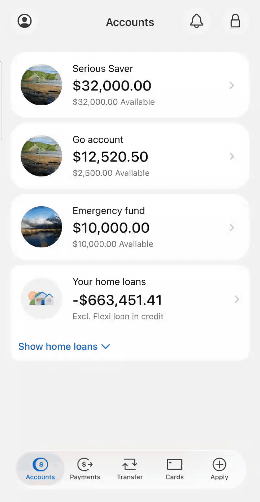
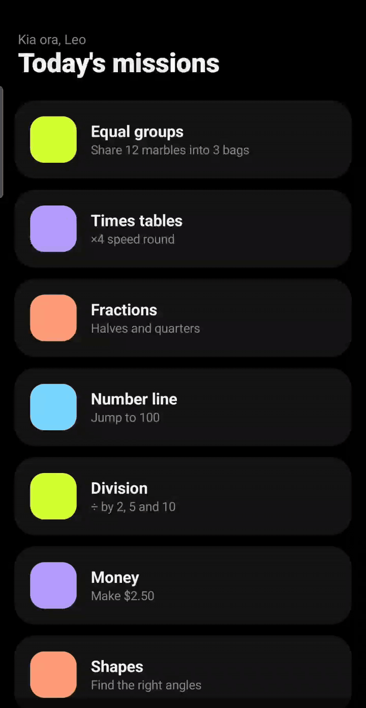

# Pull loader: two proofs

**The illusion in a nutshell:** a pull gesture brings in a hand or paw made from transparent image frames. Matching cloth shading creates the folds. At the grip, the app bends a screenshot of the interface toward the fingers using a mesh, then pulls it upward and restores the live content. Shared timing and a shared contact point make the layers look like one piece of fabric.

The screen folds under pressure. A rare moment of honesty from a financial interface.

Two Android proofs showing how a pull-to-refresh gesture can make an interface look like fabric. Recorded on a Samsung Galaxy Note 10+ on 27 October 2026.

| Hand: financial app | Kitty 1: concept app |
| --- | --- |
|  |  |

Real-time looping previews at 720 × 1392 pixels, 25 frames per second. Click either preview to view it at full size.

| Proof | Watch | How it works |
| --- | --- | --- |
| Hand: financial app | [Video](media/financial-app-hand-proof.mp4) | [Step-by-step breakdown](financial-app-hand.md) |
| Kitty 1: concept app for testing the animation | [Video](media/kitty-1-proof.mp4) | [Step-by-step breakdown](kitty-1.md) |

These are interaction prototypes. The financial screen is a reference image inside a scrollable container; the concept screen uses Compose cards. Refresh is simulated in both.

This repository contains the two explanations, screen recordings and still images. The runnable demo, source project, build files and animation frame libraries are private and are not distributed here.
