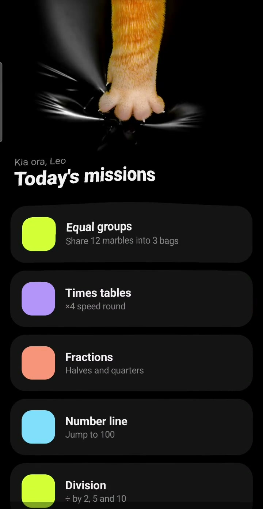

# Proof 2: Kitty 1, a concept app for testing animation

[Watch the Note 10+ recording](media/kitty-1-proof.mp4)



This concept tests the same pull loader with a paw, a faster search and a dark surface. The cards are live Compose content. The paw appears to catch the surface and haul it upward.

The paw gets a grip. That already puts it ahead of most product roadmaps.

## What happens, in order

1. **Pull.** Unused downward scroll at the top of the list opens a gap. Resistance increases with distance, and the paw reaches into view.
2. **Release.** Below 130 dp the gesture cancels. At or above that distance, the gap settles toward 210 dp and the search begins.
3. **Search.** The arm darts to +30° in 170 ms, pauses for 110 ms, darts to −24° in 200 ms, pauses for 90 ms, then returns to centre in 150 ms.
4. **Catch.** The paw presses another 10 dp into the surface over 140 ms. The toes curl over 260 ms while matching cloth folds gather over 320 ms. A firm haptic marks the catch.
5. **Haul.** The refresh callback fires when the yank begins. The paw exits over 340 ms. A distorted snapshot pulls the cards inward and upward near the grip.
6. **Release the surface.** The content targets a −9 dp overshoot over 640 ms and springs back. Bright folds fade, live cards return and the simulated refresh advances the card content.

The durations above are settings in the code, not measured frame-pacing results.

## How the code creates the illusion

**Image frames supply the paw.** Transparent search and grip images show the changing paw shape. Rotation, reach and a small delayed wrist movement make the arm feel connected to the gesture.

**A second sequence supplies the folds.** Matching cloth frames sit behind the cards. `BlendMode.Plus` adds their highlights to black: black pixels contribute nothing, bright pixels reveal the folds. The background behind the wrapped cards remains transparent so those highlights can show through.

**A mesh pulls the content toward the grip.** The code briefly replaces the live cards with their captured image. It moves mesh vertices toward the paw and raises the top of the image more than the bottom. Cloth and content share the same contact location, so the shading and distortion read as one surface.

## More detail

<details>
<summary>Frame playback and contact alignment</summary>

The same Compose state machine drives both proofs:

```text
Idle → Dragging → Searching → Grabbing → Yanking → Idle
          └→ Releasing → Idle
```

There are 16 search images and 14 grip images. Grip chooses `round(grip × 13)`. Cloth uses a fractional position through its first 14 frames during grip, then advances by elapsed time through a total of 40 cloth images at a nominal 24 fps. Neighbouring cloth frames are drawn with complementary alpha weights.

The image export stores the arm axis, fist contact point, horizontal grip correction and cloth origin. Runtime scale is proportional to screen width. These shared measurements stop the paw and the fold centre drifting apart when the screen size changes.

The wrist follows a damped response to arm angular velocity, clamped to ±7°. A velocity-based stretch makes the upward exit read as a quick pull. These are small image transforms, not a skeleton animated on the phone.

</details>

<details>
<summary>How the dark cloth and content move together</summary>

The 24 × 44 content mesh contains 1,125 vertices. A vertical falloff makes the top lead. A horizontal Gaussian centres the lift on the grip. A second local Gaussian draws nearby vertices inward over a 120 dp radius. That pinch weakens as tension rises.

During grip, the cloth origin follows the paw. During the yank, it translates with the returning sheet. Cloth playback continues after the paw has left the screen, allowing the stretched folds to relax. The gather fade begins 520 ms after yank starts and lasts 420 ms.

The host's refresh simulation waits 500 ms and changes the card selection. The snapshot holds the captured arrangement while it is being warped; the new arrangement appears when live content returns. The animation does not wait for the host operation to finish.

</details>

<details>
<summary>How the image layers were prepared</summary>

The paw was posed from open toes into a closed grip. A cloth simulation used contact constraints beneath the toes to draw the sheet toward the closing paw, with the posed paw acting as a collider. The simulation continued through the lift and release.

Each matching step was rendered as a hand layer and a cloth layer. The cloth pass hid the paw but retained its shadow. Flat-sheet sheen was removed during export so black areas contribute no light in additive compositing. Android plays those prepared layers; it does not simulate cloth during the gesture.

</details>

## What this recording proves

The supplied clip shows the darting search, grip, visible bright folds, upward exit and return to live cards on the Note 10+. This is a concept for testing the motion, with simulated refresh data. The clip is evidence of the interaction, not a performance benchmark or a production release.

[Recording details](verification.md)
